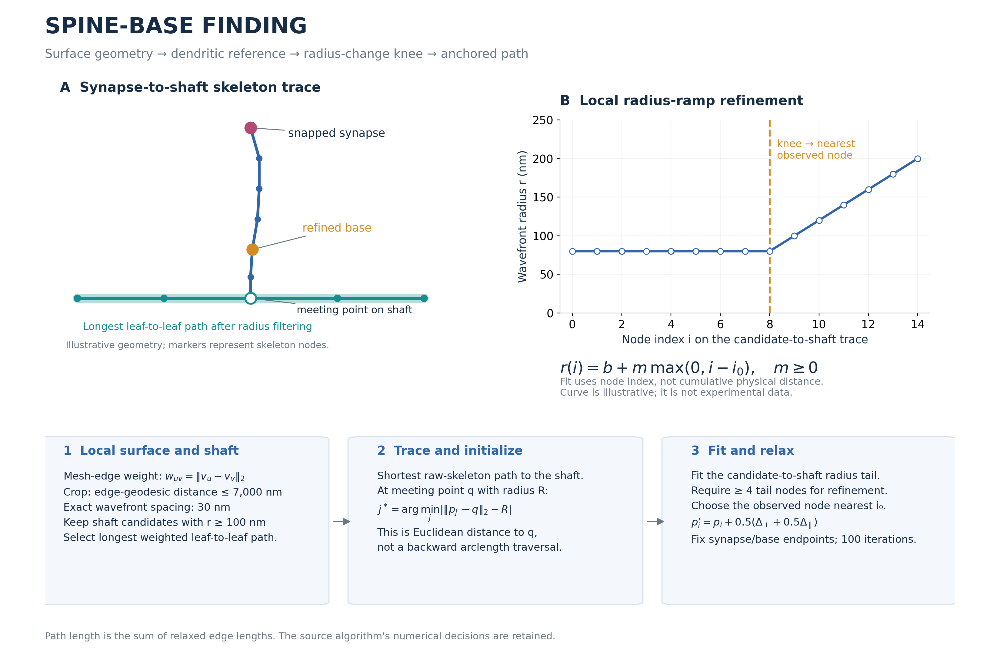
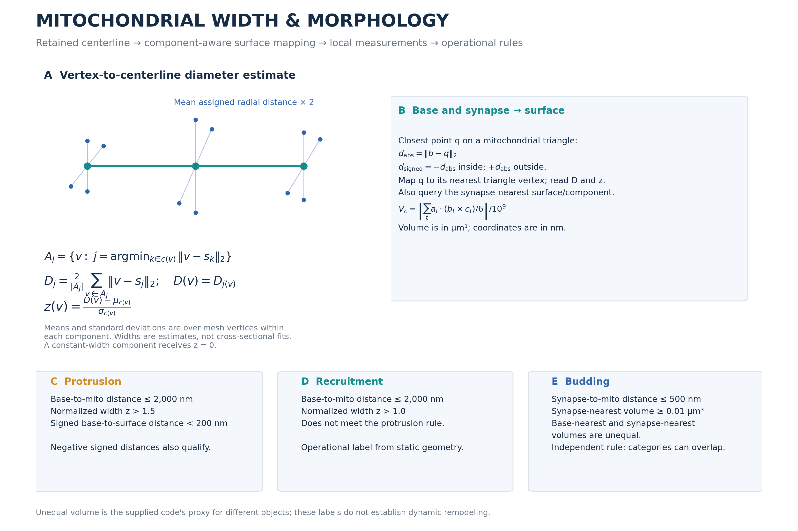

# Fig 1 and S1 — Connectomics Analysis

This folder provides a sample-based implementation of the spine-base finding algorithm, mitochondrial width mapping, and morphology classification used in the connectomics analysis. Its main purpose is to make the geometric reasoning and numerical rules inspectable on one neuron mesh and its associated synapses and mitochondria.

The numerical routines are extracted from the supplied analysis scripts without changes to their function bodies. `run_sample.py` replaces dataset-wide discovery and scheduling with a serial sample workflow. `algorithm_provenance.json` identifies the source of every retained routine. The code does not need the original dataset's folder hierarchy, neuron IDs, paired-synapse groups, or whole-dataset tables.

## Setup and sample run

Use Python 3.11 or newer supported by the dependencies. From this folder:

```bash
python setup_env.py
```

Merge the matching folder from the sample-data repository into this folder, placing the three inputs in `sample data`. On Windows PowerShell:

```powershell
.\.venv\Scripts\python.exe smoke_test.py
.\.venv\Scripts\python.exe run_sample.py
```

On macOS/Linux:

```bash
.venv/bin/python smoke_test.py
.venv/bin/python run_sample.py
```

Setup creates `.venv`, installs `requirements.txt`, checks dependencies, and preserves existing sample files. No activation is needed when invoking the environment's Python directly. If your system uses the `python3` launcher, use `python3 setup_env.py`.

The smoke test uses analytical fixtures to test the knee fit, anchored smoothing, spine graph logic, widths, surface distances, volumes, and morphology rules. It does not require the distributed sample mesh. `run_sample.py` uses your supplied sample data and runs the complete numerical workflow.

## Folder structure

```text
Fig 1 and S1 Connectomics Analysis/
├── README.md
├── requirements.txt
├── setup_env.py
├── settings.py
├── run_sample.py
├── smoke_test.py
├── make_schematics.py
├── algorithm_provenance.json
├── algorithms/
│   ├── spine_base.py
│   ├── mitochondrial_width.py
│   ├── spine_mito_mapping.py
│   └── morphology.py
├── assets/
│   ├── spine_base_math.png
│   ├── spine_base_math.svg
│   ├── mitochondrial_mapping_logic.png
│   └── mitochondrial_mapping_logic.svg
├── sample data/
│   ├── neuron.npz
│   ├── mitochondria.npz
│   └── synapses.csv
└── results/                        # created during analysis
```

The `sample data` folder is supplied empty for merging with the separate data distribution. `.gitkeep` retains it in Git. Both schematics are already included; their SVG versions are editable, and `make_schematics.py` regenerates them. Diagram geometry and radius curves are illustrative, not experimental measurements.

## Inputs and units

Both meshes are NPZ files containing:

| Array | Shape | Meaning |
| --- | --- | --- |
| `vertices` | `(N, 3)` | XYZ surface coordinates in **nanometers** |
| `faces` | `(M, 3)` | Zero-based triangular vertex indices |

`neuron.npz` must include the relevant spine and enough dendritic shaft to identify a reference path. `mitochondria.npz` contains the corresponding mitochondrial objects; disconnected mesh components represent separate objects. The meshes are loaded with `process=False`; the pipeline does not rescale, decimate, repair, or register them.

`synapses.csv` needs only these columns:

| Column | Meaning |
| --- | --- |
| `id` | Unique integer synapse identifier |
| `pos_1` | X coordinate |
| `pos_2` | Y coordinate |
| `pos_3` | Z coordinate |

Optional `contour` and `pairIdx` columns are retained for the existing rendering styles. They are not needed to detect bases or classify morphology. Without those annotations, rendering uses the existing unpaired style.

The original coordinate convention is retained: synapse positions are **voxel coordinates**, multiplied by `(11.24, 11.24, 28.0)` nm/voxel. Mesh vertices are already in nanometers. For synapse coordinates already in nanometers, set `COORDS_ARE_VOXELS = False` in `settings.py`. All inputs must refer to the same registered XYZ coordinate frame.

Filenames, input/output paths, column names, voxel size, and numerical parameters are configured in `settings.py`. To use different CSV column names, change `SYNAPSE_ID_COLUMN`, `X_COL`, `Y_COL`, and `Z_COL`. No dataset-specific neuron-ID column is required. Integer synapse IDs are needed because the retained extended SWC format stores IDs numerically.

## Spine-base finding: math and logic



The method turns a synapse-centered surface neighborhood into a skeleton trace, establishes a dendritic reference, and identifies the spine-base transition from its radius profile.

### 1. Snap and crop by surface connectivity

For a synapse coordinate $s$, select its nearest mesh vertex:

$$v_* = \arg\min_v \|s-v\|_2.$$

Make an undirected mesh-edge graph with weights

$$w_{uv}=\|v_u-v_v\|_2.$$

Dijkstra distance on this graph defines the local crop: retain vertices within 7,000 nm of $v_*$, capped at the closest 250,000 vertices. A triangle is retained only when all its vertices are selected. The crop must contain at least 300 vertices and 300 faces. This is a mesh-edge geodesic neighborhood rather than an unconstrained Euclidean ball.

### 2. Establish the dendritic reference

Run Skeletor's exact-distance wavefront skeletonization from the snapped synapse vertex with 30 nm spacing. The skeleton provides node coordinates, graph edges, and radius estimates. Skeleton edge weights are Euclidean distances between their endpoints.

Remove nodes with radius below 100 nm **from the graph used to find the shaft**. Across the remaining connected components, examine shortest paths between leaf nodes and retain the one with greatest weighted length. This is a maximum leaf-to-leaf shortest path, not an unrestricted longest simple path through a cyclic graph.

The spine trace itself is found on the **unfiltered** skeleton graph. Start at the skeleton node nearest the snapped synapse and use Dijkstra to reach the first node on the selected dendritic reference along the shortest route. The original snapped surface point is prepended to the skeleton trace.

### 3. Initialize the base using the meeting-point radius

Let $q$ be the shaft meeting point and $R$ its wavefront radius. Among trace points $p_j$, select:

$$j^*=\arg\min_j\left|\|p_j-q\|_2-R\right|.$$

This candidate uses **straight-line distance from the meeting point**. It is not a radius-length step backwards along the trace. The candidate is an observed trace point; no interpolation is introduced.

### 4. Refine with a bounded radius-ramp fit

From the raw graph node nearest the initial candidate through the meeting point, fit:

$$\hat r(i)=b+m\max(0,i-i_0),\qquad m\geq0,$$

$$\min_{b,m,i_0}\sum_i[r_i-\hat r(i)]^2,\qquad i_0\in[\min i,\max i].$$

Here $i$ is **node index**, not cumulative arclength; $m$ consequently has units nm/node. The baseline $b$ is unconstrained. The knee $i_0$ is mapped to the closest observed node index to obtain the refined base. At least four nodes in the candidate-to-shaft tail are required; otherwise the initial base is retained. Numerical fit failures are reported as failed synapses rather than silently substituting a different method.

### 5. Relax the synapse-to-base path with fixed endpoints

For interior point $p_i$, define

$$\Delta_i=\tfrac12(p_{i-1}+p_{i+1})-p_i.$$

Given its local unit tangent $t_i$, decompose

$$\Delta_{\parallel}=(\Delta_i\cdot t_i)t_i,\qquad
\Delta_{\perp}=\Delta_i-\Delta_{\parallel},$$

and update

$$p_i'=p_i+0.5(\Delta_{\perp}+0.5\Delta_{\parallel}).$$

The supplied method performs 100 iterations and keeps the synapse and base endpoints fixed. Consecutive duplicate coordinates are removed. Final spine length is

$$L=\sum_i\|p_{i+1}-p_i\|_2.$$

This relaxation smooths the path; it does not re-estimate the base or impose a mesh-interior constraint. The reported base-to-dendrite distance remains the Euclidean separation between the identified base and shaft meeting point.

The custom base-selection and refinement logic is explicit in `algorithms/spine_base.py`; wavefront skeleton construction is delegated to [Skeletor](https://navis-org.github.io/skeletor/), whose [exact wavefront documentation](https://navis-org.github.io/skeletor/skeletor/skeletonize.html) describes its distance-based spacing and radius output.

## Mitochondrial centerline and width mapping



The supplied mitochondrial routine skeletonizes the mesh and assigns skeleton components to mitochondrial mesh components by nearest-surface evidence. For each mitochondrial object, it keeps the assigned skeleton component with the longest main path and retains attached branches at least 1,000 nm long. The longest-path helper includes the source's cycle fallback. Segments between endpoints/junctions are relaxed with the same normal/tangent update, keeping their endpoints fixed.

Exact wavefront spacing is 30 nm by default. The original routine falls back to ordinary `by_wavefront` if exact skeletonization raises an exception. The ordinary API interprets its step parameter as graph hops rather than physical-distance spacing; this source behavior is retained.

For each surface vertex $v$, identify its nearest retained skeleton node $s_j$ in the same mitochondrial component. The implementation uses an augmented coordinate to separate components and invalidates any cross-component assignment. Let $A_j$ denote the surface vertices assigned to node $j$. The local diameter estimate is

$$D_j=\frac{2}{|A_j|}\sum_{v\in A_j}\|v-s_j\|_2,\qquad D(v)=D_{j(v)}.$$

This is twice the mean assigned radial distance, not a plane-fitted cross-sectional diameter. It uses discrete skeleton nodes, not nearest points on continuous skeleton segments. Nodes without assigned vertices have undefined diameter; components without a usable retained skeleton have undefined widths.

Component-normalized display values are

$$z(v)=\frac{D(v)-\mu_c}{\sigma_c},$$

where $\mu_c$ and $\sigma_c$ are the finite **surface-vertex** mean and population standard deviation within component $c$. Thus mesh sampling contributes to the weighting. A component with constant finite width receives $z=0$. Raw widths in nanometers and normalized values are both saved. Morphology thresholds below require component normalization; retain `NORMALIZE_PER_COMPONENT_DISPLAY = True` when using those rules.

## Map spine bases and synapses to mitochondrial objects

For each base $b$, VTK computes the closest point $q$ on the triangular mitochondrial surface and its containing triangle. A surface-enclosure test gives

$$d_{\mathrm{signed}}=\begin{cases}
-\|b-q\|_2 & b\text{ inside the mitochondrial surface},\\
+\|b-q\|_2 & b\text{ outside the mitochondrial surface}.
\end{cases}$$

The absolute distance is $\|b-q\|_2$. The width lookup uses the triangle vertex nearest **the closest surface point** $q$; it does not interpolate the three vertex widths. The synapse is queried separately against the surface to identify its nearest mitochondrial object and distance.

For each required mitochondrial component, its translated triangle coordinates $(a_t,b_t,c_t)$ give

$$V_c=\left|\sum_t\frac{a_t\cdot(b_t\times c_t)}6\right|/10^9\quad\mu\mathrm{m}^3.$$

Translation near the origin improves precision. Enclosure and volume interpretation require closed, consistently oriented mitochondrial surfaces; the source's automatic closed-surface check remains disabled by default. No surface repair is performed.

## Morphology rules

These are the supplied operational rules applied to finite measurements. They label static geometry and proximity; they do not by themselves measure a time-dependent remodeling event.

Define nearby mitochondria as base-to-surface **absolute** distance ≤ 2,000 nm, and widening as nearby mitochondria with normalized width $z>1.0$.

| Label | Exact rule |
| --- | --- |
| Protrusion | Widening, $z>1.5$, and signed base-to-surface distance < 200 nm |
| Recruitment | Widening that does not meet the protrusion rule |
| Budding | Synapse-to-mito surface distance ≤ 500 nm, synapse-nearest volume ≥ 0.01 µm³, and unequal base-nearest/synapse-nearest volumes |

The protrusion signed-distance criterion admits negative values, including bases inside mitochondria. The nearby filter still uses absolute distance. Budding is independent of the widening rules, so it can overlap with protrusion or recruitment. The volume inequality is the source code's proxy for different objects; it is not a component-ID inequality, and distinct objects with exactly equal volumes will not satisfy it. These details are retained in code and shown in the schematic.

The source renderer averages repeated measurements per sample/synapse before applying its rules. The sample runner saves every matching category membership without a screenshot cap, plus a measurement table labeling unmatched rows as `none`. Category rendering preserves the original top-100-per-category cap, sort order, colors, opacity, orientation, and scale settings.

## Run individual stages

To test only the main spine-base algorithm:

```powershell
.\.venv\Scripts\python.exe run_sample.py --stage spine
```

This needs only `neuron.npz` and `synapses.csv`. Other stages can be run separately:

```powershell
.\.venv\Scripts\python.exe run_sample.py --stage width
.\.venv\Scripts\python.exe run_sample.py --stage map
.\.venv\Scripts\python.exe run_sample.py --stage classify
```

`map` consumes saved spine and width outputs; `classify` consumes saved measurements. Run their preceding stages first. Relative paths in the defaults are anchored beside the scripts.

For category screenshots after the full numerical pipeline:

```powershell
.\.venv\Scripts\python.exe run_sample.py --render
```

Or render existing measurements:

```powershell
.\.venv\Scripts\python.exe run_sample.py --stage render
```

On macOS/Linux, replace the Python launcher above with `.venv/bin/python`. Rendering uses the retained VTK off-screen renderer and the machine's available graphics backend. If no synapses meet the morphology rules, no category screenshots are expected. The source defaults render the neuron faint white and selected mitochondria green; width arrays remain available in the saved NPZ files. Display switches and styling constants are in `algorithms/morphology.py`.

## Outputs

| File under `results/` | Contents |
| --- | --- |
| `spine_base_results.csv` | Per-synapse success/failure, base coordinates, raw/relaxed length, snap distance |
| `failed_synapses.csv` | Failed synapse IDs and errors |
| `spines/sample.swc` | Extended synapse-to-base paths with roles and physical distances |
| `neuron_mesh/sample.npz` | Unmodified neuron vertices/faces for the renderer |
| `synapses_metadata.csv` | Prepared synapse coordinates and optional styles |
| `mito_width/sample.npz` | Mitochondrial mesh, raw diameter, z-score, and component assignment arrays |
| `mito_skeleton/sample.npz` | Retained relaxed skeleton segments, diameters, component summaries, raw wavefront skeleton |
| `mito_component_summary.csv` | Main-path lengths and retained branch/segment counts |
| `spine_base_mito_width_synapse_size.csv` | Base/synapse surface distances, widths, component volumes, coordinates |
| `morphology_categories.csv` | One row per matching category membership |
| `measurements_with_categories.csv` | Measurement rows with all matched labels or `none` |
| `morphology_renders/` | Optional category PNG screenshots |
| `run_settings.json` | Effective settings, executed stage, Python version, elapsed time |

`sample` in generated filenames is controlled by `SAMPLE_ID`, independent of the input filenames. Extended SWC roles are 1 = synapse, 2 = path interior, and 3 = base. SWC coordinates and distances are in nanometers; the saved constant SWC radius is a display parameter, not a measured biological radius.

The sample runner recomputes its selected stages and overwrites their outputs; it does not silently reuse old results. After changing data or parameters, rerun all downstream stages or use a new output directory. Failed synapses are listed explicitly; if all fail, the runner stops rather than classifying an empty result.

## Reproducibility and scope

`settings.py` retains the supplied numerical defaults. The retained routine bodies are unchanged and were compared by their parsed Python syntax. Batch scheduling, dataset-ID discovery, and dataset-specific paths are replaced by the sample runner. New files summarize per-synapse outcomes, uncapped category memberships, and effective settings.

Dependency version ranges are provided. To record a resolved Windows environment:

```powershell
.\.venv\Scripts\python.exe -m pip freeze > requirements-resolved.txt
```


