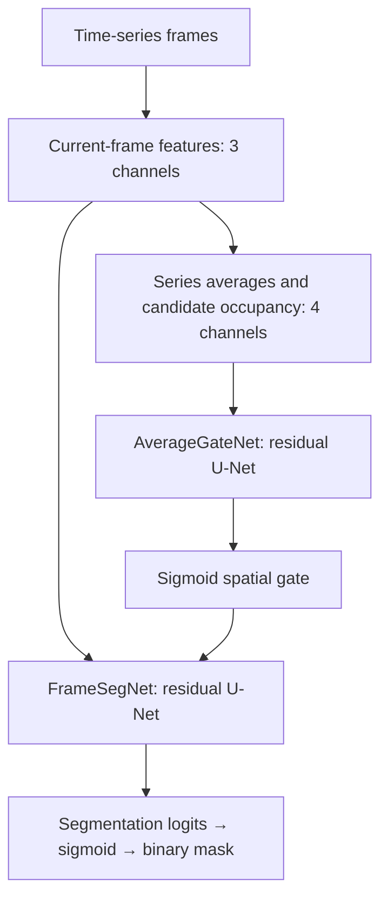

# Fig 1, 6 — Mitochondria and PSD95 deep-learning segmentation

Training and inference for mitochondrial and PSD95 time-series segmentation. Each target has its own training data, model checkpoints, feature cache, and segmentation outputs. Both use the supplied average-guided residual U-Net architecture and training settings.

## Setup

Install Python 3.11 or 3.12, extract this folder, and open a terminal in it. Run:

```bash
python setup_env.py
```

Setup creates a shared `.venv`, installs `requirements.txt`, and creates the input/output folders. Internet access is needed for dependency installation. On macOS/Linux, use `python3 setup_env.py` if your Python launcher is named `python3`.

The scripts automatically use Apple MPS when available, otherwise NVIDIA CUDA when available, otherwise CPU. Full-frame training uses substantial memory; a GPU is recommended for the original 2048 × 2048 images. CPU execution is supported but slower.

For a CPU-only PyTorch installation on Windows/Linux, run this setup command instead:

```bash
python setup_env.py --torch-index-url https://download.pytorch.org/whl/cpu
```

For an NVIDIA-specific PyTorch build, use the appropriate wheel index from the [official PyTorch installation selector](https://pytorch.org/get-started/locally/) with `--torch-index-url`.

## Merge the data folder

Merge the matching folder from the separate data repository directly into this folder. The empty input folders are included so that no code edits are needed with the following filenames:

```text
Fig 1, 6 Mitochondria and PSD95 deep-learning segmentation/
├── README.md
├── requirements.txt
├── setup_env.py
├── Mitochondria/
│   ├── train.py
│   ├── infer_all.py
│   ├── TrainingTifs/
│   │   ├── Mito.tif
│   │   └── MitoMask.tif
│   ├── InferenceTifs/
│   │   └── InferenceTifMasks/
│   └── Outputs/
│       ├── checkpoints/
│       ├── cache/
│       └── visualizations/
└── PSD95/
    ├── train.py
    ├── infer_all.py
    ├── TrainingTifs/
    │   ├── PSD95.tif
    │   └── PSD95Mask.tif
    ├── InferenceTifs/
    │   └── InferenceTifMasks/
    └── Outputs/
        ├── checkpoints/
        ├── cache/
        └── visualizations/
```

TIFF data and pretrained weights are distributed separately; this package contains the complete code. Training generates the checkpoint required by inference. Alternatively, matching pretrained `best.pt` files can be merged into each target's `Outputs/checkpoints` folder. `.gitkeep` files preserve empty folders on GitHub. The ignore rules keep merged image data and generated outputs out of code commits.

### Training inputs

Each target uses one single-channel image stack and one corresponding mask stack, both with shape `(T, Y, X)`. Image and mask shapes must match, with the same frame order and pixel alignment. Any positive mask value is foreground; zero is background. A 2D TIFF is read as one frame, but training needs enough frames for both training and validation (at least three with the default split). Spatial dimensions must be at least 16 pixels because the networks downsample four times. Square frames support the existing rotation augmentation without changing image shape.

The original training layout contains **two consecutive time series of 25 frames**, concatenated into a 50-frame stack. Frames 1–25 form one series; frames 26–50 form the other. For a different frame count, the original code divides the stack into its first and second halves. Place the two complete series in this order; do not interleave their frames. If a different series arrangement is needed, edit `get_series_ranges()` in that target's `train.py` before training.

### Inference inputs

Put individual time-series TIFF files directly in the target's `InferenceTifs` folder. Each `.tif` or `.tiff` file is processed as one complete series, with arbitrary filenames. Use lowercase extensions on case-sensitive systems. Each file should be a single-channel `(T, Y, X)` stack; a 2D image is treated as a one-frame series. The existing reader also handles simple four-dimensional channel layouts by taking channel zero, but single-channel files avoid ambiguity.

## Train and segment

Run these commands from the package's top folder. Training and inference are separate steps; inference uses the best checkpoint for the corresponding target.

### Windows PowerShell

Train mitochondria, then segment all mitochondrial inference TIFFs:

```powershell
.\.venv\Scripts\python.exe .\Mitochondria\train.py
.\.venv\Scripts\python.exe .\Mitochondria\infer_all.py
```

Train PSD95, then segment all PSD95 inference TIFFs:

```powershell
.\.venv\Scripts\python.exe .\PSD95\train.py
.\.venv\Scripts\python.exe .\PSD95\infer_all.py
```

### macOS/Linux

```bash
.venv/bin/python Mitochondria/train.py
.venv/bin/python Mitochondria/infer_all.py
.venv/bin/python PSD95/train.py
.venv/bin/python PSD95/infer_all.py
```

Paths inside the analysis scripts are anchored to each script's folder, so launching them from another working directory also works when their absolute paths are used.

## Outputs

Each target writes independently:

| Path within the target folder | Contents |
| --- | --- |
| `Outputs/checkpoints/best.pt` | Model with the lowest validation total loss; used by inference |
| `Outputs/checkpoints/latest.pt` | Most recently saved model and optimizer state for resuming training |
| `Outputs/metrics.csv` | Epoch losses, validation Dice, IoU, precision, recall, accuracy, and gate statistics |
| `Outputs/config.json` | Training configuration, class weights, and split counts |
| `Outputs/frame_split.json` | Frame-to-series assignments and training/validation frame indices |
| `Outputs/cache/` | Precomputed current-frame features, average features, and average-mask targets |
| `Outputs/visualizations/epoch_XXXX.png` | Original 12-panel feature, gate, target, prediction, and overlay figure |
| `InferenceTifs/InferenceTifMasks/` | ImageJ-compatible binary TIFF stacks with the same filenames and array dimensions as their inputs; foreground 255, background 0 |

Inference processes TIFFs directly in `InferenceTifs`; it does not recurse into output folders. Rerunning inference replaces masks with matching filenames.

## Model architecture

The architecture consists of two residual 2D U-Nets: an average-feature gate network and a gate-guided frame segmentation network. Each frame is segmented in 2D, while features averaged over its entire time series provide temporal context.



Current-frame features are the global z-score, local z-score, and gradient magnitude of the local z-score. Local normalization uses Gaussian sigma 12 pixels; the gradient uses sigma 1 pixel. Z-score features are clipped to ±6. The average network receives the series means of those three features plus the fraction of frames with local z-score greater than 0.5.

| Network | Encoder channels | Bottleneck channels | Decoder channels |
| --- | --- | --- | --- |
| `AverageGateNet` | 16, 32, 64, 128 | 256 | 128, 64, 32, 16 |
| `FrameSegNet` | 24, 48, 96, 192 | 384 | 192, 96, 48, 24 |

Each residual block has two 3 × 3 convolutions with GroupNorm and SiLU, plus an identity or 1 × 1 projection shortcut. Encoders downsample with 2 × 2 max pooling; decoders upsample with transposed convolutions and concatenate encoder features. Spatial interpolation reconciles differing encoder/decoder sizes. Each bottleneck contains a downsampling block followed by another residual block. A final 1 × 1 convolution produces logits.

The sigmoid average gate is concatenated with the three current-frame features and modulates the frame network's four skip connections:

$$s' = s \,[0.10 + (2.00 - 0.10)g], \qquad g \in [0,1].$$

The gate is a learned spatial prior, rather than a hard foreground mask. The prediction threshold is 0.5. Training and inference retain the same architecture and feature definitions.

## Training objective and defaults

The segmentation loss is positive-weighted binary cross-entropy plus soft Dice loss. The positive weight is the background/foreground pixel ratio across the full training input mask, capped at 50. The average-gate target is the series' mean binary mask, Gaussian-smoothed with sigma 3 pixels and min–max normalized when nonconstant. Its loss is unweighted binary cross-entropy plus soft Dice loss:

$$L = L_{\mathrm{BCE,weighted}} + L_{\mathrm{Dice}} + 0.20\,(L_{\mathrm{gate,BCE}} + L_{\mathrm{gate,Dice}}).$$

Defaults are 100 epochs, batch size 1, AdamW with learning rate `1e-4` and weight decay `1e-5`, and seed 1. Augmentation applies intensity scaling, offsets, signed gamma, Gaussian noise, flips, and 90-degree rotations. Training runs on complete frames without patch extraction. The original augmentation, plotting styles, losses, metrics, and checkpoint selection are retained.

The default validation split randomly holds out 20% of frames, rather than holding out entire time series or biological samples. Series-level average features and average-mask targets are constructed from all frames in each series, including validation frames. Thus the reported validation scores describe this within-series protocol and are not an independent held-out-series evaluation. Inference needs only images and a checkpoint, and uses the complete input series to compute its average features.

## Configuration, resuming, and replacing data

Settings are at the top of each target's scripts. Change `MITO_TIF` and `MASK_TIF` in `train.py` to use different training filenames; the internal `MITO_TIF` variable is also used for PSD95. In `infer_all.py`, `INPUT_DIR`, `OUTPUT_MASK_DIR`, and `CHECKPOINT_PATH` control inference paths. No changes are required with the documented folder layout.

`RESUME = True` resumes training from `latest.pt` when present. `EPOCHS` is the final epoch number, so increase it to continue beyond a completed run. For a fresh model or different training data, use a fresh target-folder copy or remove that target's generated `Outputs` contents before starting. This clears checkpoints, previous metrics, and feature caches. Cached features can be reused by shape, so they must also be removed when image data, masks, series grouping, or feature settings change, even if TIFF dimensions stay the same.

If network widths, normalization settings, clipping, or gate scales are changed, use matching settings in training and inference and a compatible checkpoint. Inference prints stored checkpoint settings but does not automatically apply them. TIFF files, model checkpoints, and other data can be merged from the parallel data repository without filling in any code or documentation placeholders.
